# IAM SSO & Lifecycle Lab
 
A hands-on identity and access management lab built on **Okta (Integrator Free Plan)**. It covers single sign-on over OIDC and SAML, MFA and authentication policy, group-based access control, and automated joiner/mover/leaver provisioning.
 
> All users, groups, and data in this lab are fictional. Org URLs, the custom domain, client IDs, and tokens are redacted.
 
## Contents
 
- [Goals](#goals)
- [Progress](#progress)
- [Architecture](#architecture)
- [Directory Design](#directory-design)
- [Key Concepts Demonstrated](#key-concepts-demonstrated)
- [Part 1 – Tenant and Directory Setup](#part-1--tenant-and-directory-setup)
- [Part 2 – OIDC Integration](#part-2--oidc-integration)
- [Troubleshooting Log](#troubleshooting-log)
- [Production Considerations](#production-considerations)
- [Cleanup](#cleanup)
## Goals
 
- Stand up an identity provider (IdP) with a structured directory
- Integrate applications using **OIDC** and **SAML**
- Enforce **MFA with phishing-resistant possession factors** and group-based access policies
- Automate the **identity lifecycle** (joiner / mover / leaver)
- Document design decisions and troubleshooting like a production rollout
## Progress
 
| Phase | Status |
|---|---|
| Tenant, custom domain, and directory | ✅ Complete |
| OIDC integration (OIDC Debugger) | ✅ Complete |
| SAML integration | ⬜ Planned |
| Group-based authentication policies (stricter MFA for IT_Admins) | ⬜ Planned |
| Joiner / mover / leaver automation (SCIM / API) | ⬜ Planned |
 
## Architecture
 
```
 ┌──────────────┐   1. sign-in request    ┌──────────────────────┐
 │   User        │ ─────────────────────▶ │  Okta (IdP)          │
 │ (Kenny, Eng)  │                         │  ─ Directory/Groups  │
 └──────────────┘ ◀── 3. ID token ──────── │  ─ Auth policies     │
        │                                  │  ─ Auth server       │
        │ 4. token presented               └──────────────────────┘
        ▼                                            ▲
 ┌──────────────┐        2. MFA (FastPass / passkey) │
 │ App (SP)      │ ───────────────────────────────────┘
 │ OIDC Debugger │
 └──────────────┘
```
 
## Directory Design
 
| Group | Purpose | Members |
|---|---|---|
| Engineering | Access to engineering apps | Alice Chen, Bob Martinez, Kenny Vital |
| Sales | Sales tools only | Carol Smith |
| HR | HR systems; future source of lifecycle events | Evan Brooks |
| IT_Admins | Elevated access; stricter MFA (planned) | Dana Lee |
 
## Key Concepts Demonstrated
 
- **Authentication vs. authorization:** Okta proves *who* Kenny is (password plus a possession factor), then policy decides *what* he can access.
- **Three layers of access control.** A request must pass all three:
  1. **App assignment:** is the user assigned the app (via group)?
  2. **Authentication policy:** how strongly must they authenticate?
  3. **Authorization server access policy:** which clients, grant types, and scopes may receive tokens?
- **Signing in to Okta is not authorization for an app.** Carol (Sales) can sign in to her Okta dashboard, but her OIDC request is denied because she isn't assigned the app.
- **Least privilege:** only Engineering is assigned the app; the redirect URI is a single exact URL with wildcards off; the Device Authorization grant is not enabled; Self Service is disabled.
---
 
## Part 1 – Tenant and Directory Setup
 
### 1. Custom domain and admin email
 
Okta's Integrator Free Plan requires a **business email address** at signup; personal providers such as Gmail are rejected. To keep the lab separate from any employer, I:
 
1. Registered a custom domain through **Namecheap** (WHOIS privacy on, 2FA enabled on the registrar account).
2. Configured **Namecheap email forwarding**:
   - `admin@<domain>` → personal inbox (Okta admin account)
   - `*@<domain>` catch-all → personal inbox (receives mail for test users)
3. Verified delivery with a test email before signing up.
**Why it matters:** the admin email is the recovery path for the whole tenant. Whoever controls the domain controls the IdP, so the registrar account is protected with MFA.
 
### 2. Okta org
 
- Plan: **Okta Integrator Free Plan** (not the 30-day trial)
- Admin MFA: **Okta Verify** enrolled at first login
### 3. Groups
 
Created under **Directory → Groups**:
 
| Group | Description |
|---|---|
| Engineering | Engineering staff; assigned engineering apps |
| Sales | Sales staff |
| HR | HR staff; future authoritative source for lifecycle |
| IT_Admins | IT administrators; target for stricter policy |
 
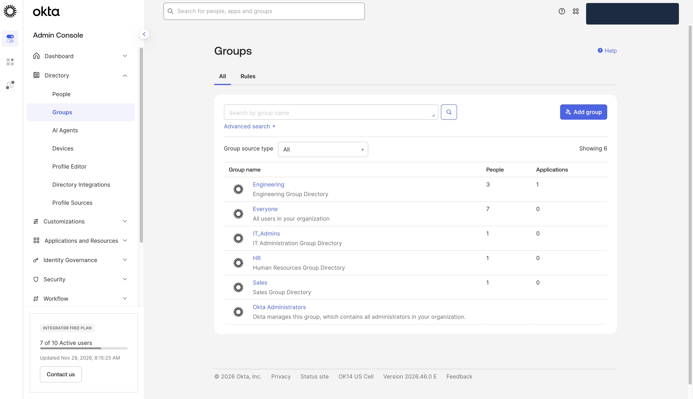
 
### 4. Users
 
Created under **Directory → People → Add person**, activated immediately with an admin-set password:
 
| Name | Username | Group |
|---|---|---|
| Alice Chen | alice.chen@\<domain\> | Engineering |
| Bob Martinez | bob.martinez@\<domain\> | Engineering |
| Kenny Vital | kenny.vital@\<domain\> | Engineering |
| Carol Smith | carol.smith@\<domain\> | Sales |
| Evan Brooks | evan.brooks@\<domain\> | HR |
| Dana Lee | dana.lee@\<domain\> | IT_Admins |
 
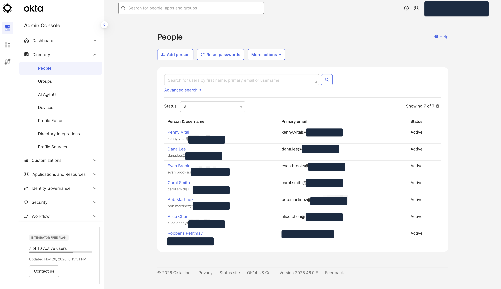
 
### 5. MFA at first sign-in
 
The org's default **authenticator enrollment policy** required each user to enroll a security method on first login. Kenny was prompted to enroll Okta Verify or a passkey before reaching his dashboard, which confirms MFA is enforced from day one.
 
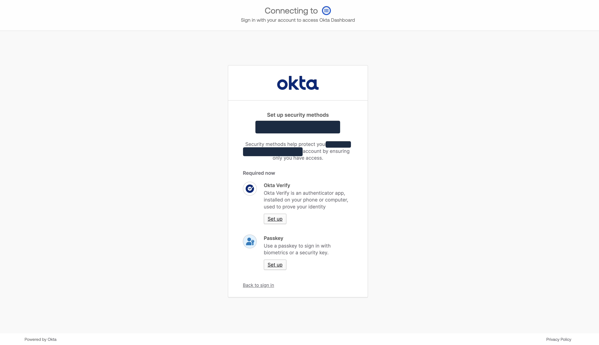
 
---
 
## Part 2 – OIDC Integration
 
**Goal:** sign a user in to an application over OpenID Connect and inspect the ID token Okta issues.
 
The "application" is **OIDC Debugger** (oidcdebugger.com), a tool that acts as a relying party and displays the token it receives.
 
### 1. App integration
 
**Applications → Create App Integration → OIDC – Web Application**
 
| Setting | Value | Reason |
|---|---|---|
| Name | OIDC Debugger Lab | — |
| Client ID | Okta-generated | No legacy system requires a custom ID |
| Client authentication | Client secret | Default for a web app; PKCE not additionally required (see Production Considerations) |
| Grant types | Authorization Code; Implicit (hybrid) with ID token and access token allowed | Implicit used **only** to view the ID token directly in the debugger |
| Client Credentials | Off | Machine-to-machine; no user involved |
| Sign-in redirect URI | `https://oidcdebugger.com/debug` (wildcards off) | Single exact URL; replaced the localhost default |
| Sign-out redirect URI | *(none)* | Not used |
| User consent | Required | Default for the app |
| Assignment | Group: **Engineering** | Group-based access control |
| Self Service | Disabled | Access is admin-granted, not user-requested |
 
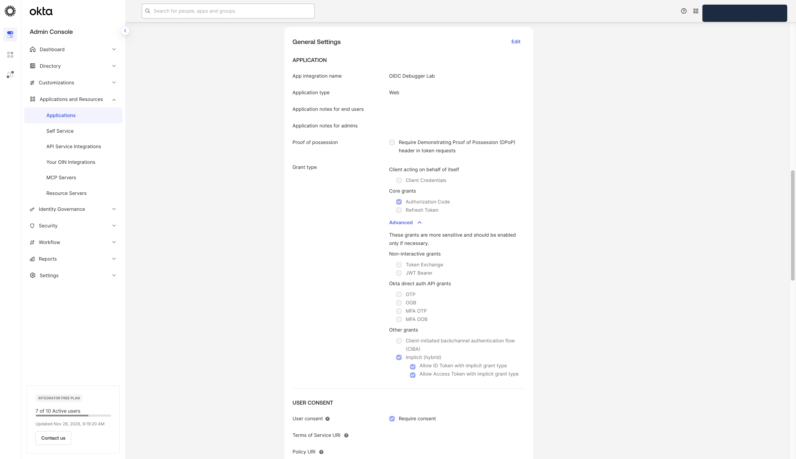
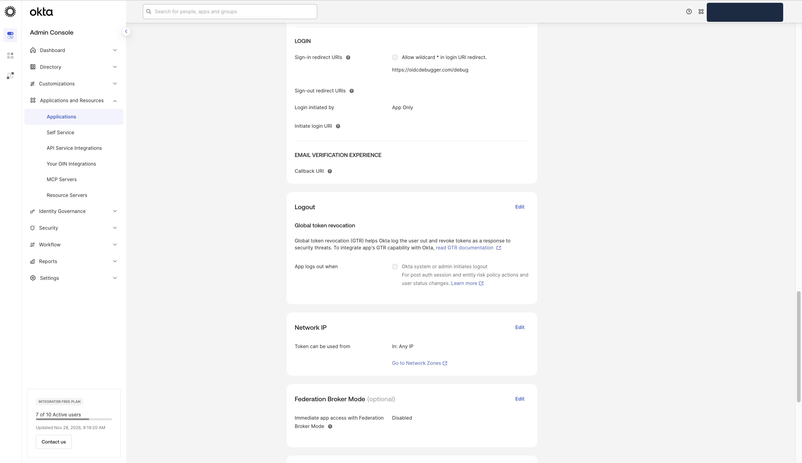
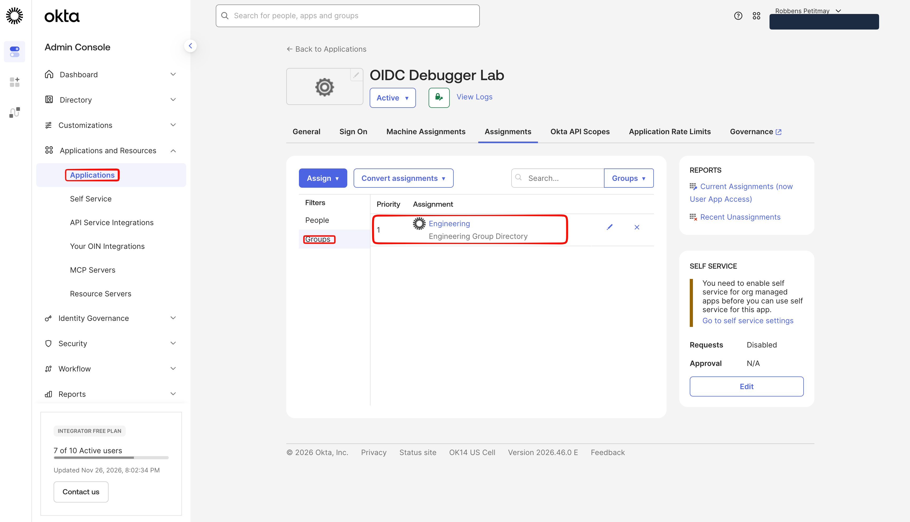
 
### 2. Groups claim
 
**Security → API → Authorization Servers → default → Claims**
 
| Name | Include in | Value type | Filter |
|---|---|---|---|
| groups | ID Token, Always | Groups | Matches regex `.*` |
 
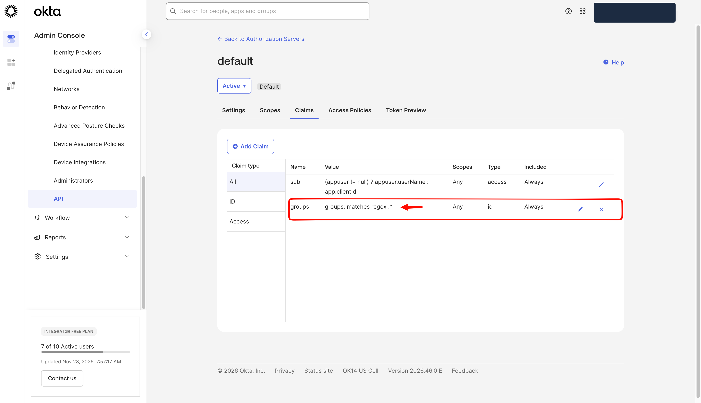
 
### 3. Authentication policy

Added a rule **above** the catch-all in the **Any two factors** app sign-in policy:

- **Rule:** Engineering Access (priority 1)
- **Condition:** group = Engineering
- **Access:** two factor types; the possession factor must be phishing-resistant (Okta Verify FastPass or passkey), with user interaction required
- **Re-authentication:** every 1 hour (the catch-all uses 12 hours)

Rules are evaluated top-down and the first match wins. The catch-all also requires two factors with a phishing-resistant possession factor, and additionally excludes phone and email authenticators.

The policy is shared by 4 apps: three Okta system apps (Access Certification Reviews, Workflows, Workflows OAuth) and OIDC Debugger Lab.

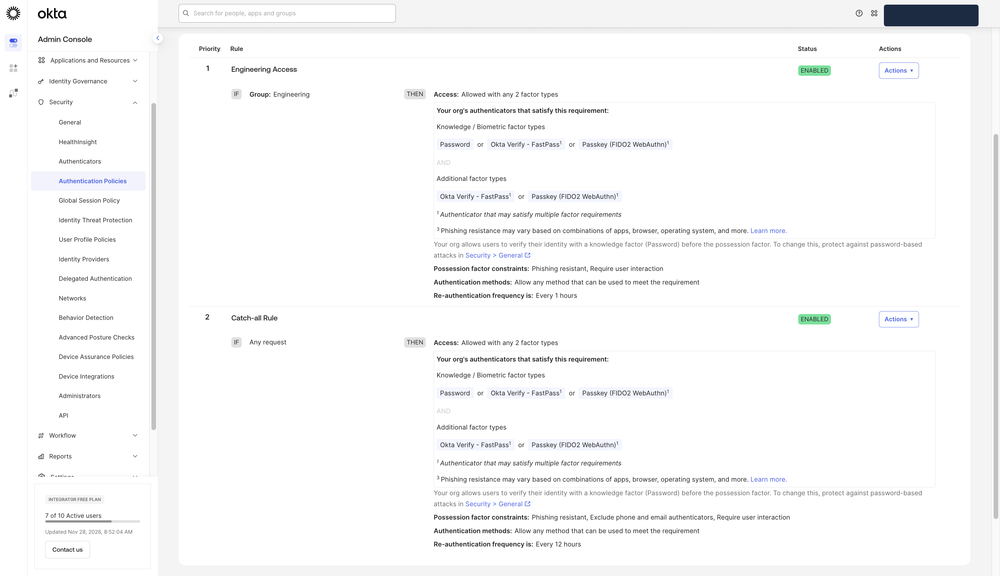
 
### 4. Authorization server access policy
 
**Security → API → Authorization Servers → default → Access Policies**
 
- **Policy:** assigned to the OIDC Debugger Lab client
- **Rule:** grant types Authorization Code + Implicit (hybrid); any user assigned the app; any scopes
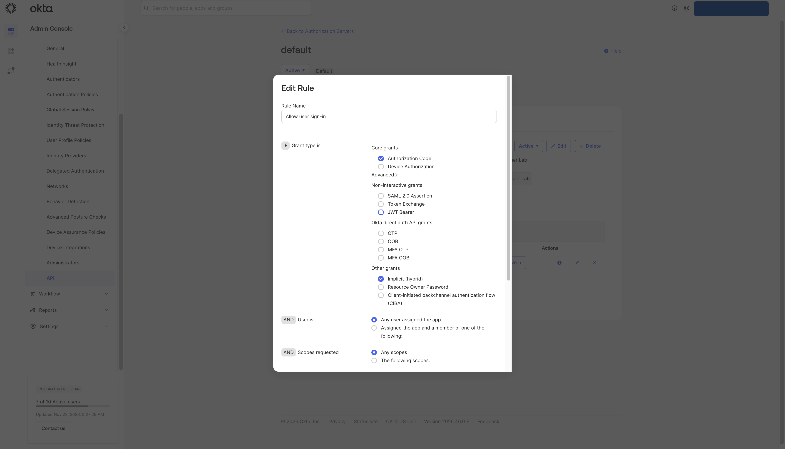
 
### 5. Request
 
| Field | Value |
|---|---|
| Authorize URI | `https://<org>.okta.com/oauth2/default/v1/authorize` |
| Scope | `openid profile email` |
| Response type | `id_token` |
| Response mode | `form_post` |
 
### 6. Results
 
#### ✅ Kenny (Engineering): token issued
 
Decoded at jwt.io:
 
| Claim | Meaning |
|---|---|
| `iss` | Issuer: the Okta default authorization server |
| `aud` | Audience: this app's Client ID |
| `sub` | Stable unique user ID |
| `exp` / `iat` | Expiry / issued-at timestamps |
| `email`, `name` | Profile claims from the `email` and `profile` scopes |
| `amr` | `pwd`, `pop`, `mfa`: password plus a possession factor, recorded as MFA |
| `groups` | Group membership: `Engineering` and `Everyone` |
| `nonce` | Ties the token to this request (replay protection) |
 
`Everyone` appears because the claim filter `.*` returns every group the user belongs to. Production would use a narrower filter.
 
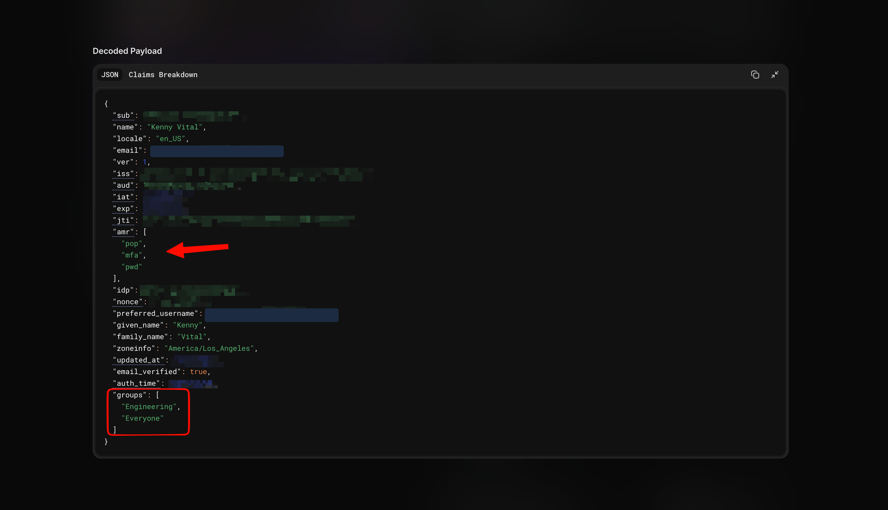
 
#### ❌ Carol (Sales): denied
 
Carol is not assigned the app, so Okta blocked the request with a 400 `access_denied` ("User is not assigned to the client application"). This is the expected negative test. The System Log records it as `app.generic.unauth_app_access_attempt`, outcome FAILURE, severity WARN, target OIDC Debugger Lab.
 
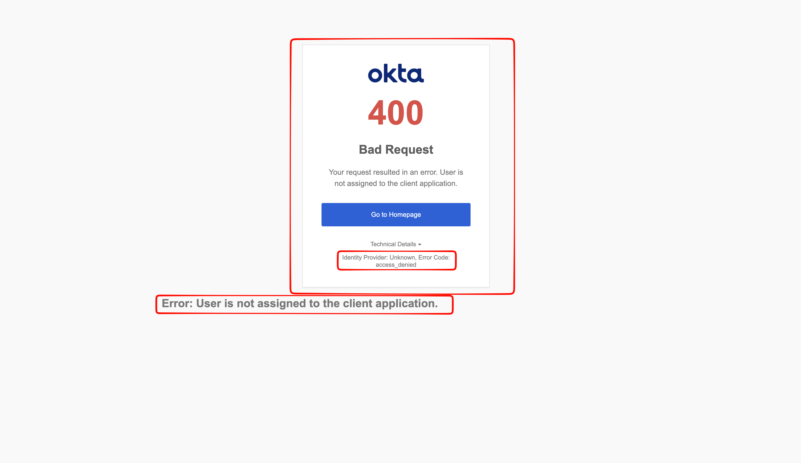
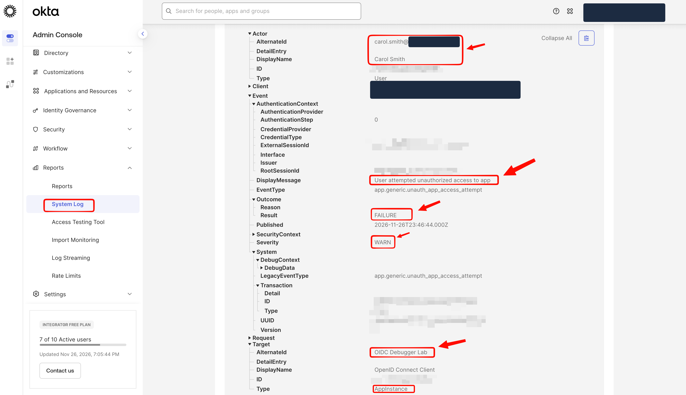
 
> **Signing in to Okta is not authorization for an app.** Carol authenticates to Okta successfully, but app assignment is checked separately, so the request fails.
 
### 7. Takeaway: three layers of access control
 
```
Request ──▶ [1] App assignment ──▶ [2] Authentication policy ──▶ [3] Auth server access policy ──▶ Token
              (Carol fails here)      (how strong is MFA?)          (which grants/scopes allowed?)
```
 
---
 
## Troubleshooting Log
 
Real issues hit while building this lab: the symptom, the root cause, and the fix.
 
> **Method:** after each failure I checked **Reports → System Log** for the failed event before changing any settings.
 
### 1. Okta signup rejected personal email
 
- **Symptom:** "Business email required" on the Integrator Free Plan signup.
- **Cause:** Okta free orgs only accept corporate-domain email addresses.
- **Fix:** registered a custom domain and set up email forwarding (`admin@<domain>` → personal inbox). Avoided using a work email so the lab stays independent of any employer.
### 2. Engineering group not offered during app assignment
 
<!-- CONFIRM: cause and exact steps for this entry -->
- **Symptom:** the group picker in the app creation wizard did not list the Engineering group.
- **Fix:** skipped assignment in the wizard and assigned the group afterward under **App → Assignments → Groups**.
### 3. Test user forced to set up security methods
 
- **Symptom:** Kenny was prompted to enroll an authenticator on first sign-in.
- **Cause:** expected behavior; the default authenticator enrollment policy requires MFA.
- **Fix:** enrolled an authenticator. MFA was left on deliberately.
### 4. Only FastPass or a passkey accepted as the second factor
 
<!-- CONFIRM: which authenticator you actually used -->
- **Symptom:** the rule summary listed only Okta Verify FastPass and passkey as additional factors.
- **Cause:** the rule's possession-factor constraint is "Phishing resistant, Require user interaction". The password can be the first factor, but only phishing-resistant authenticators satisfy the second. Okta notes that phishing resistance varies by app, browser, and OS.
- **Fix:** completed enrollment with an eligible authenticator. Relaxing the constraint was possible but unnecessary.
### 5. 400 Bad Request at the authorize endpoint
 
<!-- CONFIRM: what was wrong with the first request -->
- **Symptom:** "400 Bad Request – Your request resulted in an error."
- **Cause:** the OIDC request did not match the app configuration.
- **Fix:** used the org's non-admin domain with `/oauth2/default/v1/authorize`, confirmed by loading `/.well-known/openid-configuration`.
- **Note:** this is a different 400 from entry 8. Read the message text and check the System Log to tell them apart.
### 6. "Policy evaluation failed for this request"
 
- **Symptom:** the request got past app sign-on but no token was issued.
- **Cause:** the **default authorization server** had no access policy rule covering this client and the **Implicit** grant type.
- **Fix:** added an access policy assigned to the client, with a rule allowing Authorization Code + Implicit for any user assigned the app.
- **Lesson:** app sign-on policy and authorization server policy are separate layers, and both must allow the request.
### 7. Self Service warning
 
- **Symptom:** "Self Service cannot be enabled for this app because it is not enabled for the org."
- **Cause:** informational; Self Service is off org-wide.
- **Fix:** none needed. Left disabled on purpose, since access is granted by group assignment.
### 8. 400 "User is not assigned to the client application" (Carol)
 
- **Symptom:** after authenticating, Carol got a 400 with `access_denied`.
- **Cause:** Carol (Sales) isn't assigned the app. The System Log shows `app.generic.unauth_app_access_attempt`, FAILURE, severity WARN.
- **Fix:** none; this is the intended negative test.
### 9. `groups` claim missing from the ID token
 
- **Symptom:** the ID token contained no `groups` claim.
- **Cause:** the claim existed but had no filter, so Okta emitted no groups.
- **Fix:** set the filter to **Matches regex `.*`**. Kenny's token then showed `Engineering` and `Everyone`.
- **Lesson:** a groups claim needs a filter. `.*` returns every group, so production should use a narrow filter.
### Quick reference
 
| Error | Layer | Where to look |
|---|---|---|
| 400 "User is not assigned to the client application" | App assignment | App → Assignments; System Log |
| 400 Bad Request (generic) | Request configuration | OIDC Debugger fields vs. app settings |
| Policy evaluation failed | Authorization server | Security → API → Authorization Servers → Access Policies |
| No `groups` claim in token | Claims | Authorization Servers → default → Claims (check the filter) |
 
---
 
## Production Considerations
 
- Use **Authorization Code + PKCE** and disable the implicit grant (implicit, including access-token-via-implicit, was enabled here only to inspect ID tokens easily). Require PKCE on the app.
- Narrow the `groups` claim filter so apps only receive the groups they need, not `Everyone` and every other group.
- Scope access policy rules to specific scopes and groups instead of "any scopes".
- Manage Okta configuration as code (e.g., the Okta Terraform provider) for review and repeatability.
- Separate admin accounts from day-to-day accounts; require phishing-resistant MFA for all admins.
- Forward the Okta System Log to a SIEM for alerting on failed policy evaluations and admin changes.
- Keep a break-glass admin account with documented recovery steps.
## Cleanup
 
After the lab: delete the test users, remove the `*@<domain>` catch-all forwarding, and delete the OIDC app and unused policies.
 
## Tools
 
Okta Integrator Free Plan · OIDC Debugger · jwt.io · Namecheap (custom domain + email forwarding)
 
